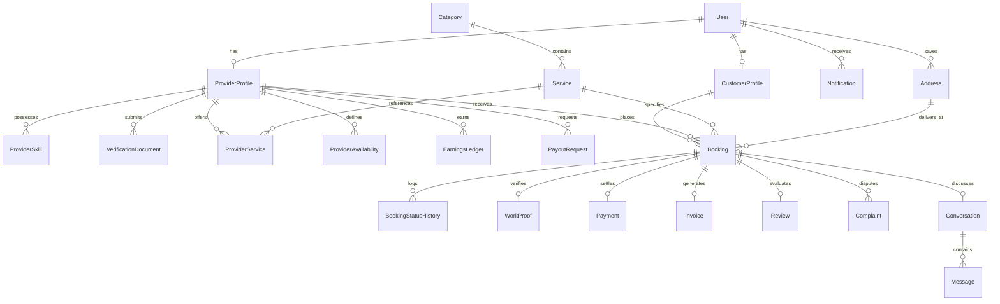

# Database Design & Entity-Relationship Specification (DATABASE_DESIGN.md)
## Project: HomeBuddy – Smart Home Service Booking Marketplace
**Owner:** Atul Patel (TYBSc Computer Science)  
**Database Engine:** MySQL 8.0+ (InnoDB Engine, UTF8MB4 charset)  
**ORM:** Django 5.x ORM with strict foreign keys, indexes, and constraints  
**Monetary Precision:** `DecimalField(max_digits=10, decimal_places=2)`  

---

## 1. Entity-Relationship (ER) Diagram

---

## 2. Comprehensive Data Dictionary

### 2.1 App: `accounts`

#### Table: `accounts_user`
Primary authentication entity extending Django's `AbstractUser`.
| Column Name | Type | Modifiers / Constraints | Description |
|---|---|---|---|
| `id` | BigAutoField | PRIMARY KEY | Unique user identifier |
| `username` | VARCHAR(150) | UNIQUE, NOT NULL | Unique handle or phone number |
| `email` | VARCHAR(254) | UNIQUE, NOT NULL, INDEX | Primary email address |
| `phone` | VARCHAR(15) | UNIQUE, NOT NULL, INDEX | 10-digit mobile number |
| `password` | VARCHAR(128) | NOT NULL | PBKDF2 SHA-256 hashed password |
| `role` | VARCHAR(20) | NOT NULL, DEFAULT 'CUSTOMER' | Choice: `CUSTOMER`, `PROVIDER`, `ADMIN` |
| `is_active` | BOOLEAN | NOT NULL, DEFAULT TRUE | Account active/suspended flag |
| `is_staff` | BOOLEAN | NOT NULL, DEFAULT FALSE | Access to Django Admin / Management |
| `date_joined` | DATETIME | NOT NULL | Timestamp of registration |

---

### 2.2 App: `customers`

#### Table: `customers_customerprofile`
| Column Name | Type | Modifiers / Constraints | Description |
|---|---|---|---|
| `id` | BigAutoField | PRIMARY KEY | Unique profile ID |
| `user_id` | BIGINT | UNIQUE, FK -> `accounts_user(id)` ON DELETE CASCADE | Associated user account |
| `avatar` | VARCHAR(255) | NULLABLE | Uploaded profile picture path |
| `emergency_contact_name` | VARCHAR(100) | NULLABLE | Emergency contact person name |
| `emergency_contact_phone`| VARCHAR(15) | NULLABLE | Emergency phone number |
| `created_at` | DATETIME | NOT NULL | Profile creation timestamp |

#### Table: `customers_address`
| Column Name | Type | Modifiers / Constraints | Description |
|---|---|---|---|
| `id` | BigAutoField | PRIMARY KEY | Address ID |
| `user_id` | BIGINT | FK -> `accounts_user(id)` ON DELETE CASCADE, INDEX | Associated customer |
| `title` | VARCHAR(50) | NOT NULL, DEFAULT 'Home' | Choice: `Home`, `Office`, `Other` |
| `address_line1` | VARCHAR(255) | NOT NULL | Flat/Building, Street name |
| `address_line2` | VARCHAR(255) | NULLABLE | Area / Locality (e.g. Kothrud, Baner) |
| `landmark` | VARCHAR(150) | NULLABLE | Nearby reference landmark |
| `city` | VARCHAR(100) | NOT NULL, DEFAULT 'Pune' | City |
| `state` | VARCHAR(100) | NOT NULL, DEFAULT 'Maharashtra'| State |
| `pincode` | VARCHAR(10) | NOT NULL, INDEX | 6-digit postal code |
| `is_default` | BOOLEAN | NOT NULL, DEFAULT FALSE | Default address flag |

---

### 2.3 App: `professionals`

#### Table: `professionals_providerprofile`
| Column Name | Type | Modifiers / Constraints | Description |
|---|---|---|---|
| `id` | BigAutoField | PRIMARY KEY | Provider profile ID |
| `user_id` | BIGINT | UNIQUE, FK -> `accounts_user(id)` ON DELETE CASCADE | Associated user account |
| `business_name` | VARCHAR(150) | NULLABLE | Trading / Trade name |
| `avatar` | VARCHAR(255) | NULLABLE | Professional headshot path |
| `bio` | TEXT | NULLABLE | Professional summary / experience notes |
| `experience_years` | INT | NOT NULL, DEFAULT 1 | Years in trade |
| `is_verified` | BOOLEAN | NOT NULL, DEFAULT FALSE, INDEX | Verified badge status |
| `verification_date`| DATETIME | NULLABLE | Timestamp of admin KYC approval |
| `avg_rating` | DECIMAL(3,2) | NOT NULL, DEFAULT 5.00 | Calculated rating (1.00 to 5.00) |
| `total_reviews` | INT | NOT NULL, DEFAULT 0 | Count of customer reviews |
| `total_jobs_completed` | INT | NOT NULL, DEFAULT 0 | Total jobs completed |
| `service_city` | VARCHAR(100) | NOT NULL, DEFAULT 'Pune' | Primary operating city |
| `service_pincodes` | TEXT | NULLABLE | Comma-separated covered pincodes |

#### Table: `professionals_verificationdocument`
| Column Name | Type | Modifiers / Constraints | Description |
|---|---|---|---|
| `id` | BigAutoField | PRIMARY KEY | Document ID |
| `provider_id` | BIGINT | FK -> `professionals_providerprofile(id)` ON DELETE CASCADE | Associated provider |
| `document_type` | VARCHAR(30) | NOT NULL | Choice: `AADHAAR`, `PAN`, `POLICE_VERIFICATION`, `SKILL_CERTIFICATE` |
| `document_file` | VARCHAR(255) | NOT NULL | Protected storage document file path |
| `status` | VARCHAR(20) | NOT NULL, DEFAULT 'PENDING' | Choice: `PENDING`, `APPROVED`, `REJECTED` |
| `admin_notes` | TEXT | NULLABLE | Reason for rejection or approval remarks |
| `submitted_at` | DATETIME | NOT NULL | Submission timestamp |
| `reviewed_at` | DATETIME | NULLABLE | Admin decision timestamp |

#### Table: `professionals_providerskill`
| Column Name | Type | Modifiers / Constraints | Description |
|---|---|---|---|
| `id` | BigAutoField | PRIMARY KEY | Skill ID |
| `provider_id` | BIGINT | FK -> `professionals_providerprofile(id)` ON DELETE CASCADE | Associated provider |
| `skill_name` | VARCHAR(100) | NOT NULL | e.g., 'AC Repair', 'Deep Cleaning' |
| `years_experience` | INT | NOT NULL, DEFAULT 1 | Years of expertise |

#### Table: `professionals_provideravailability`
| Column Name | Type | Modifiers / Constraints | Description |
|---|---|---|---|
| `id` | BigAutoField | PRIMARY KEY | Availability slot ID |
| `provider_id` | BIGINT | FK -> `professionals_providerprofile(id)` ON DELETE CASCADE | Associated provider |
| `day_of_week` | SMALLINT | NOT NULL | 0 = Monday, 6 = Sunday |
| `start_time` | TIME | NOT NULL, DEFAULT '09:00:00' | Shift start |
| `end_time` | TIME | NOT NULL, DEFAULT '18:00:00' | Shift end |
| `is_available` | BOOLEAN | NOT NULL, DEFAULT TRUE | Working day toggle |

---

### 2.4 App: `services`

#### Table: `services_category`
| Column Name | Type | Modifiers / Constraints | Description |
|---|---|---|---|
| `id` | BigAutoField | PRIMARY KEY | Category ID |
| `name` | VARCHAR(100) | UNIQUE, NOT NULL | Category name (e.g. Deep Cleaning) |
| `slug` | VARCHAR(120) | UNIQUE, NOT NULL, INDEX | URL slug |
| `description` | TEXT | NULLABLE | Detailed description |
| `icon_name` | VARCHAR(50) | NOT NULL, DEFAULT 'bi-tools' | Bootstrap icon or SVG identifier |
| `image` | VARCHAR(255) | NULLABLE | Category header banner image |
| `display_order` | INT | NOT NULL, DEFAULT 0 | Display sequence order |
| `is_active` | BOOLEAN | NOT NULL, DEFAULT TRUE | Active listing flag |

#### Table: `services_service`
| Column Name | Type | Modifiers / Constraints | Description |
|---|---|---|---|
| `id` | BigAutoField | PRIMARY KEY | Service ID |
| `category_id` | BIGINT | FK -> `services_category(id)` ON DELETE CASCADE | Parent category |
| `name` | VARCHAR(150) | NOT NULL | Service title |
| `slug` | VARCHAR(170) | UNIQUE, NOT NULL, INDEX | URL slug |
| `short_description` | VARCHAR(255)| NOT NULL | Brief summary for cards |
| `detailed_description` | TEXT | NOT NULL | Full scope of service |
| `image` | VARCHAR(255) | NULLABLE | Service thumbnail image |
| `pricing_type` | VARCHAR(20) | NOT NULL, DEFAULT 'FIXED' | Choice: `FIXED`, `HOURLY`, `PACKAGE` |
| `base_price` | DECIMAL(10,2)| NOT NULL | Base charge in INR (₹) |
| `estimated_duration_minutes` | INT | NOT NULL, DEFAULT 60 | Estimated time required |
| `is_emergency_eligible` | BOOLEAN | NOT NULL, DEFAULT FALSE | Allows emergency dispatch |
| `emergency_surcharge` | DECIMAL(10,2)| NOT NULL, DEFAULT 0.00 | Extra fee for emergency jobs |
| `is_active` | BOOLEAN | NOT NULL, DEFAULT TRUE | Active toggle |

#### Table: `services_providerservice`
| Column Name | Type | Modifiers / Constraints | Description |
|---|---|---|---|
| `id` | BigAutoField | PRIMARY KEY | Mapping ID |
| `provider_id` | BIGINT | FK -> `professionals_providerprofile(id)` ON DELETE CASCADE | Technician |
| `service_id` | BIGINT | FK -> `services_service(id)` ON DELETE CASCADE | Offered service |
| `custom_price` | DECIMAL(10,2)| NULLABLE | Provider custom quote (if overrides base) |
| `is_active` | BOOLEAN | NOT NULL, DEFAULT TRUE | Currently offered flag |

---

### 2.5 App: `bookings`

#### Table: `bookings_booking`
Core transaction engine record.
| Column Name | Type | Modifiers / Constraints | Description |
|---|---|---|---|
| `id` | BigAutoField | PRIMARY KEY | Internal ID |
| `booking_number` | VARCHAR(32) | UNIQUE, NOT NULL, INDEX | Human-readable code e.g. `HB-2026-89421` |
| `customer_id` | BIGINT | FK -> `customers_customerprofile(id)` ON DELETE PROTECT | Customer placing booking |
| `provider_id` | BIGINT | NULLABLE, FK -> `professionals_providerprofile(id)` ON DELETE SET NULL | Assigned technician |
| `service_id` | BIGINT | FK -> `services_service(id)` ON DELETE PROTECT | Booked service |
| `address_id` | BIGINT | FK -> `customers_address(id)` ON DELETE PROTECT | Service delivery location |
| `scheduled_date` | DATE | NOT NULL, INDEX | Appointment date |
| `time_slot` | VARCHAR(30) | NOT NULL | e.g. '09:00 AM - 11:00 AM' |
| `is_emergency` | BOOLEAN | NOT NULL, DEFAULT FALSE | Emergency booking flag |
| `special_instructions` | TEXT | NULLABLE | Customer requirements |
| `status` | VARCHAR(30) | NOT NULL, DEFAULT 'REQUESTED', INDEX | State machine status |
| `rejection_reason` | TEXT | NULLABLE | Reason given by provider if declined |
| `cancellation_reason` | TEXT | NULLABLE | Reason if cancelled |
| `service_price` | DECIMAL(10,2)| NOT NULL | Service baseline price |
| `emergency_fee` | DECIMAL(10,2)| NOT NULL, DEFAULT 0.00 | Emergency surcharge (if applicable) |
| `discount_amount` | DECIMAL(10,2)| NOT NULL, DEFAULT 0.00 | Applied coupon discount |
| `total_amount` | DECIMAL(10,2)| NOT NULL | Final payable amount |
| `created_at` | DATETIME | NOT NULL | Booking timestamp |
| `updated_at` | DATETIME | NOT NULL | Last modified timestamp |

#### Table: `bookings_bookingstatushistory`
| Column Name | Type | Modifiers / Constraints | Description |
|---|---|---|---|
| `id` | BigAutoField | PRIMARY KEY | History ID |
| `booking_id` | BIGINT | FK -> `bookings_booking(id)` ON DELETE CASCADE | Associated booking |
| `from_status` | VARCHAR(30) | NULLABLE | Prior state |
| `to_status` | VARCHAR(30) | NOT NULL | New state |
| `changed_by_id` | BIGINT | NULLABLE, FK -> `accounts_user(id)` ON DELETE SET NULL | User who changed state |
| `notes` | TEXT | NULLABLE | State transition comments |
| `created_at` | DATETIME | NOT NULL | Timestamp |

#### Table: `bookings_workproof`
Mandatory verification of completed service.
| Column Name | Type | Modifiers / Constraints | Description |
|---|---|---|---|
| `id` | BigAutoField | PRIMARY KEY | Proof ID |
| `booking_id` | BIGINT | UNIQUE, FK -> `bookings_booking(id)` ON DELETE CASCADE | Associated booking |
| `before_photo` | VARCHAR(255) | NOT NULL | Image taken prior to commencing work |
| `after_photo` | VARCHAR(255) | NOT NULL | Image taken upon completing work |
| `work_notes` | TEXT | NOT NULL | Technician description of work done |
| `submitted_at` | DATETIME | NOT NULL | Proof upload timestamp |
| `customer_confirmed`| BOOLEAN | NOT NULL, DEFAULT FALSE | Customer acceptance sign-off |
| `customer_confirmed_at`| DATETIME | NULLABLE | Sign-off timestamp |
| `customer_feedback` | TEXT | NULLABLE | Comments upon sign-off |

---

### 2.6 App: `payments`

#### Table: `payments_payment`
| Column Name | Type | Modifiers / Constraints | Description |
|---|---|---|---|
| `id` | BigAutoField | PRIMARY KEY | Payment record ID |
| `booking_id` | BIGINT | UNIQUE, FK -> `bookings_booking(id)` ON DELETE PROTECT | Associated booking |
| `amount` | DECIMAL(10,2)| NOT NULL | Amount paid |
| `payment_method` | VARCHAR(20) | NOT NULL | Choice: `ONLINE_RAZORPAY`, `CASH` |
| `status` | VARCHAR(20) | NOT NULL, DEFAULT 'PENDING' | Choice: `PENDING`, `SUCCESS`, `FAILED`, `REFUNDED` |
| `razorpay_order_id` | VARCHAR(100)| NULLABLE, INDEX | Razorpay order reference |
| `razorpay_payment_id`| VARCHAR(100)| NULLABLE, INDEX | Gateway transaction reference |
| `razorpay_signature` | VARCHAR(255)| NULLABLE | HMAC-SHA256 signature string |
| `cash_received_by_provider`| BOOLEAN| NOT NULL, DEFAULT FALSE | Technician cash receipt acknowledgment |
| `created_at` | DATETIME | NOT NULL | Payment initiation timestamp |
| `updated_at` | DATETIME | NOT NULL | Payment completion timestamp |

#### Table: `payments_earningsledger`
Financial tracking for technician payouts and platform commission.
| Column Name | Type | Modifiers / Constraints | Description |
|---|---|---|---|
| `id` | BigAutoField | PRIMARY KEY | Ledger entry ID |
| `provider_id` | BIGINT | FK -> `professionals_providerprofile(id)` ON DELETE PROTECT | Beneficiary technician |
| `booking_id` | BIGINT | UNIQUE, FK -> `bookings_booking(id)` ON DELETE PROTECT | Source booking |
| `gross_amount` | DECIMAL(10,2)| NOT NULL | Customer payment amount |
| `commission_rate` | DECIMAL(5,2) | NOT NULL, DEFAULT 10.00 | Platform fee percentage (e.g. 10%) |
| `commission_amount`| DECIMAL(10,2)| NOT NULL | Platform retained commission |
| `net_earnings` | DECIMAL(10,2)| NOT NULL | Technician payable amount |
| `is_paid_out` | BOOLEAN | NOT NULL, DEFAULT FALSE | Payout disbursement status |
| `created_at` | DATETIME | NOT NULL | Ledger creation timestamp |

#### Table: `payments_payoutrequest`
| Column Name | Type | Modifiers / Constraints | Description |
|---|---|---|---|
| `id` | BigAutoField | PRIMARY KEY | Payout request ID |
| `provider_id` | BIGINT | FK -> `professionals_providerprofile(id)` ON DELETE PROTECT | Requesting technician |
| `amount` | DECIMAL(10,2)| NOT NULL | Requested withdrawal amount |
| `bank_account_name` | VARCHAR(100)| NOT NULL | Bank account beneficiary |
| `bank_account_number`| VARCHAR(30) | NOT NULL | Masked bank account |
| `bank_ifsc` | VARCHAR(20) | NOT NULL | Bank branch IFSC code |
| `status` | VARCHAR(20) | NOT NULL, DEFAULT 'REQUESTED' | Choice: `REQUESTED`, `APPROVED`, `REJECTED`, `TRANSFERRED` |
| `admin_reference` | VARCHAR(100)| NULLABLE | Bank transaction UTR / Reference ID |
| `admin_notes` | TEXT | NULLABLE | Remarks from finance admin |
| `requested_at` | DATETIME | NOT NULL | Timestamp of request |
| `processed_at` | DATETIME | NULLABLE | Timestamp of approval/settlement |

#### Table: `payments_invoice`
| Column Name | Type | Modifiers / Constraints | Description |
|---|---|---|---|
| `id` | BigAutoField | PRIMARY KEY | Invoice record ID |
| `invoice_number` | VARCHAR(40) | UNIQUE, NOT NULL, INDEX | e.g. `INV-2026-00412` |
| `booking_id` | BIGINT | UNIQUE, FK -> `bookings_booking(id)` ON DELETE CASCADE | Associated booking |
| `subtotal` | DECIMAL(10,2)| NOT NULL | Booking subtotal |
| `tax_amount` | DECIMAL(10,2)| NOT NULL, DEFAULT 0.00 | Estimated GST/Tax (if applicable) |
| `total_amount` | DECIMAL(10,2)| NOT NULL | Total paid |
| `pdf_file` | VARCHAR(255) | NULLABLE | Generated PDF invoice file path |
| `created_at` | DATETIME | NOT NULL | Invoice issue timestamp |

---

### 2.7 App: `reviews`

#### Table: `reviews_review`
| Column Name | Type | Modifiers / Constraints | Description |
|---|---|---|---|
| `id` | BigAutoField | PRIMARY KEY | Review ID |
| `booking_id` | BIGINT | UNIQUE, FK -> `bookings_booking(id)` ON DELETE CASCADE | Unique review per booking |
| `customer_id` | BIGINT | FK -> `customers_customerprofile(id)` ON DELETE CASCADE | Reviewing customer |
| `provider_id` | BIGINT | FK -> `professionals_providerprofile(id)` ON DELETE CASCADE | Evaluated technician |
| `rating` | SMALLINT | NOT NULL | Star rating (1 to 5) |
| `review_text` | TEXT | NOT NULL | Written evaluation |
| `is_approved` | BOOLEAN | NOT NULL, DEFAULT TRUE | Moderation approval flag |
| `created_at` | DATETIME | NOT NULL | Submission timestamp |

---

### 2.8 App: `complaints`

#### Table: `complaints_complaint`
| Column Name | Type | Modifiers / Constraints | Description |
|---|---|---|---|
| `id` | BigAutoField | PRIMARY KEY | Ticket ID |
| `complaint_number`| VARCHAR(32) | UNIQUE, NOT NULL, INDEX | e.g. `CMP-2026-00109` |
| `booking_id` | BIGINT | FK -> `bookings_booking(id)` ON DELETE CASCADE | Associated booking |
| `raised_by_id` | BIGINT | FK -> `accounts_user(id)` ON DELETE CASCADE | Customer or technician |
| `category` | VARCHAR(40) | NOT NULL | `POOR_QUALITY`, `DAMAGE`, `NO_SHOW`, `OVERCHARGING`, `OTHER` |
| `description` | TEXT | NOT NULL | Detailed dispute description |
| `evidence_file` | VARCHAR(255) | NULLABLE | Photo / receipt evidence path |
| `status` | VARCHAR(20) | NOT NULL, DEFAULT 'OPEN' | Choice: `OPEN`, `INVESTIGATING`, `RESOLVED`, `CLOSED` |
| `admin_resolution`| TEXT | NULLABLE | Resolution remarks and outcome |
| `created_at` | DATETIME | NOT NULL | Ticket creation timestamp |
| `updated_at` | DATETIME | NOT NULL | Resolution timestamp |

---

### 2.9 App: `messaging` & `notifications`

#### Table: `messaging_conversation`
| Column Name | Type | Modifiers / Constraints | Description |
|---|---|---|---|
| `id` | BigAutoField | PRIMARY KEY | Conversation thread ID |
| `booking_id` | BIGINT | UNIQUE, FK -> `bookings_booking(id)` ON DELETE CASCADE | 1 conversation per booking |
| `created_at` | DATETIME | NOT NULL | Started timestamp |
| `updated_at` | DATETIME | NOT NULL | Last message timestamp |

#### Table: `messaging_message`
| Column Name | Type | Modifiers / Constraints | Description |
|---|---|---|---|
| `id` | BigAutoField | PRIMARY KEY | Message ID |
| `conversation_id`| BIGINT | FK -> `messaging_conversation(id)` ON DELETE CASCADE | Parent thread |
| `sender_id` | BIGINT | FK -> `accounts_user(id)` ON DELETE CASCADE | Sender |
| `content` | TEXT | NOT NULL | Chat message text |
| `is_read` | BOOLEAN | NOT NULL, DEFAULT FALSE | Read receipt status |
| `created_at` | DATETIME | NOT NULL | Sent timestamp |

#### Table: `notifications_notification`
| Column Name | Type | Modifiers / Constraints | Description |
|---|---|---|---|
| `id` | BigAutoField | PRIMARY KEY | Notification ID |
| `user_id` | BIGINT | FK -> `accounts_user(id)` ON DELETE CASCADE, INDEX | Recipient user |
| `title` | VARCHAR(150) | NOT NULL | Short notification header |
| `message` | TEXT | NOT NULL | Body copy |
| `notification_type`| VARCHAR(30)| NOT NULL | `BOOKING`, `PAYMENT`, `VERIFICATION`, `CHAT`, `SYSTEM` |
| `link_url` | VARCHAR(255) | NULLABLE | Target page URL |
| `is_read` | BOOLEAN | NOT NULL, DEFAULT FALSE | Read flag |
| `created_at` | DATETIME | NOT NULL, INDEX | Notification timestamp |
