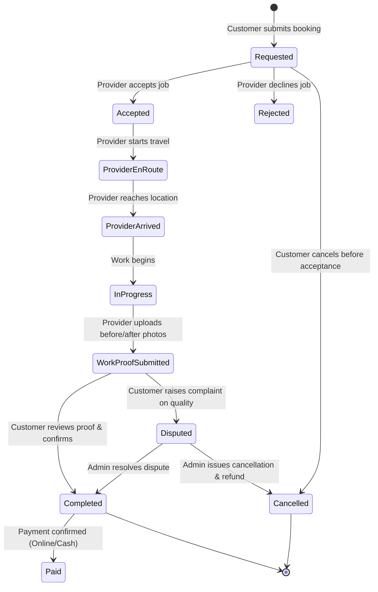

# Software Requirements Specification (SRS)
## Project: HomeBuddy – Smart Home Service Booking Marketplace
**Owner:** Atul Patel  
**Level:** TYBSc Computer Science Mini Project  
**Version:** 1.0 (Session 01 Baseline)  
**Status:** Approved for Planning  

---

## 1. Introduction & Problem Statement

### 1.1 Purpose
The purpose of HomeBuddy is to provide a unified, transparent, and secure digital platform for urban households to schedule domestic services (electricians, plumbers, deep cleaners, painters, carpenters, cooks, appliance repairs) while offering skilled local blue-collar workers direct access to clients, fair pricing, and automated earnings reconciliation.

### 1.2 Problem Statement
In the unorganized domestic services market:
- **For Customers:** Finding dependable, background-verified technicians is difficult, pricing is opaque and subject to last-minute inflation, appointment timings are unpredictable, and there is zero recourse or accountability if substandard work is performed.
- **For Service Providers:** Local technicians lack marketing reach, face irregular job opportunities, suffer delayed or withheld customer payments, and lack digital proof of work to resolve disputes.
- **For Administrators/Marketplace Operators:** Coordinating manual bookings, handling complaints, verifying worker identity, and distributing commission payouts is unmanageable without an automated centralized platform.

### 1.3 System Objectives
1. Provide a responsive, accessible web portal for guests, customers, service professionals, and marketplace admins.
2. Implement strict identity verification for technicians with tamper-evident badges.
3. Facilitate seamless service discovery by category, price, rating, and locality.
4. Support scheduled bookings and emergency on-demand requests.
5. Provide multi-mode payments: Cash on Service (COS) and Razorpay online gateway test mode.
6. Enforce work proof verification through mandatory before-and-after job photography.
7. Support customer reviews, complaints management, in-app notifications, and booking-linked messaging.

---

## 2. Requirements Traceability Matrix (RTM)
This matrix maps all 30 official synopsis requirements to their architectural module, database entities, endpoints, templates, and verification test cases.

| Req # | Synopsis Requirement | Module | Target Database Models | Target URLs / Endpoints | Target Templates / Views | Test Case ID | Status |
|---|---|---|---|---|---|---|---|
| **REQ-01** | Customer registration & login | `accounts` | `User`, `CustomerProfile` | `/accounts/register/`, `/accounts/login/` | `accounts/register.html`, `accounts/login.html` | `TC-AUTH-01` | Planned |
| **REQ-02** | Service provider registration & login | `accounts` | `User`, `ProviderProfile` | `/accounts/register/provider/` | `accounts/provider_register.html` | `TC-AUTH-02` | Planned |
| **REQ-03** | Customer profiles | `customers` | `CustomerProfile`, `Address` | `/customer/profile/`, `/customer/addresses/` | `customer/profile.html`, `customer/addresses.html` | `TC-CUST-01` | Planned |
| **REQ-04** | Worker/professional profiles | `professionals` | `ProviderProfile` | `/professionals/<id>/`, `/provider/profile/edit/` | `professionals/public_profile.html`, `provider/edit_profile.html` | `TC-PRO-01` | Planned |
| **REQ-05** | Professional skills and experience | `professionals` | `ProviderSkill`, `ProviderProfile` | `/provider/skills/` | `provider/skills_manage.html` | `TC-PRO-02` | Planned |
| **REQ-06** | Verification badge for verified professionals | `professionals` | `ProviderProfile.is_verified` | Public profile & search cards | Component: `badges/verified_badge.html` | `TC-PRO-03` | Planned |
| **REQ-07** | Service categories (electrician, cleaner, etc.) | `services` | `Category`, `Service` | `/services/`, `/services/category/<slug>/` | `services/category_detail.html` | `TC-SERV-01` | Planned |
| **REQ-08** | Service booking | `bookings` | `Booking` | `/bookings/create/<service_id>/` | `bookings/booking_form.html` | `TC-BOOK-01` | Planned |
| **REQ-09** | Transparent hourly or task-based pricing | `services`, `bookings` | `Service.pricing_type`, `ProviderService` | Booking summary & quotation | `bookings/summary_card.html` | `TC-BOOK-02` | Planned |
| **REQ-10** | Preferred date and time selection | `bookings` | `Booking.scheduled_date`, `time_slot` | `/bookings/create/` (time picker) | `bookings/booking_form.html` | `TC-BOOK-03` | Planned |
| **REQ-11** | Location-based provider discovery | `services`, `customers` | `Address.pincode`, `ProviderServiceArea` | `/services/search/?locality=...` | `services/search_results.html` | `TC-LOC-01` | Planned |
| **REQ-12** | Emergency booking | `bookings` | `Booking.is_emergency`, `emergency_fee` | `/bookings/emergency/` | `bookings/emergency_booking.html` | `TC-BOOK-04` | Planned |
| **REQ-13** | Online payment (Razorpay test mode) | `payments` | `Payment`, `PaymentTransaction` | `/payments/checkout/<booking_id>/`, `/payments/callback/` | `payments/checkout.html` | `TC-PAY-01` | Planned |
| **REQ-14** | Cash-on-service payment | `payments` | `Payment.method='CASH'` | `/payments/cash-confirm/<booking_id>/` | `payments/cash_confirmation.html` | `TC-PAY-02` | Planned |
| **REQ-15** | Ratings & reviews after service | `reviews` | `Review` | `/reviews/create/<booking_id>/` | `reviews/write_review.html` | `TC-REV-01` | Planned |
| **REQ-16** | Before-and-after work photos | `bookings` | `WorkProof` | `/provider/bookings/<id>/work-proof/` | `provider/upload_proof.html` | `TC-PROOF-01` | Planned |
| **REQ-17** | Written work confirmation | `bookings` | `WorkProof.work_notes`, `customer_confirmed` | `/customer/bookings/<id>/confirm/` | `customer/confirm_completion.html` | `TC-PROOF-02` | Planned |
| **REQ-18** | Customer-provider communication | `messaging` | `Conversation`, `Message` | `/messages/booking/<id>/` | `messaging/chat_window.html` | `TC-MSG-01` | Planned |
| **REQ-19** | Booking notifications | `notifications` | `Notification` | `/notifications/`, bell dropdown | `notifications/list.html` | `TC-NOTIF-01` | Planned |
| **REQ-20** | Provider arrival & completion alerts | `notifications`, `bookings` | `Notification`, `BookingStatusHistory` | `/provider/bookings/<id>/status/` | In-app alerts & toast banners | `TC-NOTIF-02` | Planned |
| **REQ-21** | Admin management of users | `admin_dashboard` | `User`, `CustomerProfile` | `/admin-panel/users/` | `admin_dashboard/users_list.html` | `TC-ADM-01` | Planned |
| **REQ-22** | Admin management of workers | `admin_dashboard` | `ProviderProfile` | `/admin-panel/workers/` | `admin_dashboard/workers_list.html` | `TC-ADM-02` | Planned |
| **REQ-23** | Admin management of bookings | `admin_dashboard` | `Booking` | `/admin-panel/bookings/` | `admin_dashboard/bookings_list.html` | `TC-ADM-03` | Planned |
| **REQ-24** | Admin management of complaints | `complaints` | `Complaint` | `/admin-panel/complaints/` | `complaints/admin_complaints.html` | `TC-COMP-01` | Planned |
| **REQ-25** | Payment records & invoice generation | `payments` | `Payment`, `Invoice` | `/customer/invoices/<id>/download/` | `payments/invoice_pdf.html` | `TC-PAY-03` | Planned |
| **REQ-26** | Service history | `bookings` | `Booking` | `/customer/bookings/history/` | `customer/booking_history.html` | `TC-CUST-02` | Planned |
| **REQ-27** | Guest browsing without booking | `core`, `services` | Public models | `/`, `/services/`, `/categories/` | `public/index.html`, `public/services.html` | `TC-GST-01` | Planned |
| **REQ-28** | Verified professional management | `admin_dashboard` | `VerificationDocument`, `ProviderProfile` | `/admin-panel/verifications/` | `admin_dashboard/verification_queue.html` | `TC-ADM-04` | Planned |
| **REQ-29** | Customer dashboard | `dashboard` | Aggregated models | `/customer/dashboard/` | `customer/dashboard.html` | `TC-DASH-01` | Planned |
| **REQ-30** | Service provider dashboard | `dashboard` | Aggregated models | `/provider/dashboard/` | `provider/dashboard.html` | `TC-DASH-02` | Planned |

---

## 3. User Roles and Permission Matrix

| Function / Resource | Guest | Customer | Service Provider | Admin |
|---|---|---|---|---|
| View Public Landing Page, Categories, FAQ | Allowed | Allowed | Allowed | Allowed |
| Search & Filter Public Services / Profiles | Allowed | Allowed | Allowed | Allowed |
| Book a Service (Standard / Emergency) | Denied | **Allowed** | Denied | Denied |
| Manage Personal Saved Addresses | Denied | **Allowed** | Denied | Denied |
| Cancel Booking (Within policy window) | Denied | **Allowed (Own)** | **Allowed (Own)** | **Allowed (Any)** |
| Upload Professional KYC Documents | Denied | Denied | **Allowed** | Read-Only |
| Approve / Reject KYC Verifications | Denied | Denied | Denied | **Allowed** |
| Accept / Decline Incoming Bookings | Denied | Denied | **Allowed (Own)** | Admin Override |
| Mark Arrival & Upload Work Proof Photos | Denied | Denied | **Allowed (Assigned)**| Read-Only |
| Confirm Service Completion & Sign-off | Denied | **Allowed (Own)** | Denied | Admin Override |
| Pay for Booking (Online or Cash) | Denied | **Allowed (Own)** | Denied | Denied |
| Submit Review & Star Rating | Denied | **Allowed (Completed)**| Denied | Moderate Only |
| Raise Complaint / Dispute | Denied | **Allowed (Own)** | **Allowed (Own)** | **Allowed (Resolve)**|
| View Earnings Ledger & Request Payout | Denied | Denied | **Allowed (Own)** | Approve/Reject |
| Platform Analytics & System Reports | Denied | Denied | Denied | **Allowed** |

---

## 4. Booking State Machine & Transition Logic
A booking advances strictly through validated states with relational audit records created in `BookingStatusHistory`.

### Transition Invariants:
1. `WorkProofSubmitted` requires at least one before-work and one after-work photo.
2. `Completed` triggers platform commission calculation and creates an `EarningsLedger` entry for the technician.
3. Review submission is locked until the booking is in `Completed` state and no duplicate review exists.
4. Cancellation refund logic evaluates cancellation timestamp against scheduled time (free cancellation up to 4 hours prior).

---

## 5. Non-Functional Requirements
- **Performance:** Response time under 200ms for database queries; pagination enabled (10 items/page) on all listing and history endpoints.
- **Security:** CSRF tokens required on all mutating POST/PUT requests; Django password hashers (PBKDF2 SHA-256); strict sanitization of user-submitted text to prevent XSS.
- **Data Integrity:** All monetary calculations run through `Decimal`; all status transitions wrapped in atomic transactions.
- **Responsive Design:** Native fluid breakpoints supporting 360px (mobile), 768px (tablet), and 1200px+ (desktop).
